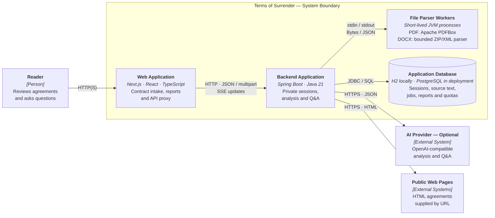

# Terms of Surrender

### The fine print. Finally, in plain English.

Understand what you're agreeing to **before you click “I agree.”** Terms of Surrender turns subscriptions, gym memberships, app terms, and freelance contracts into plain-English findings—with the exact wording behind each one.

**Find the terms that matter. See the evidence. Know what to ask next.**

[](https://github.com/rishuyadav/terms-of-surrender/actions/workflows/ci.yml)
[](https://github.com/rishuyadav/terms-of-surrender/stargazers)

**[Try the live demo →](https://terms-of-surrender.vercel.app)** · [Watch the demo](#see-it-in-action) · [Architecture](#architecture-in-brief) · [Run locally](#running-locally) · [Explore the docs](#documentation)

No account required · Source-backed findings · Rules-based preview works without an AI key

> **Early preview, not an AI lawyer.** This project explains contract text and surfaces questions worth asking. It does not give legal advice or decide whether a clause is enforceable.

## See it in action


See the app in action before trying an agreement of your own.

## From “I agree” to “I understand”

The important part of a contract isn't always the longest paragraph. It might be a renewal deadline, a cancellation charge, or a sentence transferring ownership of your work before you're paid.

Terms of Surrender helps you take a second look:

1. **Bring an agreement.** Paste text, upload a text-based PDF or DOCX, or paste a public HTTPS URL and fetch its readable text. Optionally add your location, agreement type, and state or region to focus the review.
2. **Read what matters.** Explore plain-English explanations, practical implications, and exact quotes highlighted in the source.
3. **Know your next move.** Review suggested questions, copy an action checklist, and export your report.

**Just looking?** The demo includes four fictional agreements: a US gym membership, an Indian app subscription, a US freelance contract, and an Indian services agreement. Try a report without uploading your own document. These are demonstrations, not templates to sign.

## What makes it useful

| Feature | What you get |
| --- | --- |
| **Evidence, not just assertions** | Every finding must cite an exact passage found in your document. Jump to the highlighted wording and inspect the surrounding context. Unsupported quotes are rejected. |
| **Consequential clauses in plain English** | Review renewal deadlines, trial conversion, cancellation costs, arbitration, payment conditions, IP ownership, termination, and more. Coverage depends on the analysis mode. |
| **Context that focuses the review** | Choose **United States**, **India**, or **unspecified**, and **consumer/subscription**, **freelance/services**, or **other** agreement. Optionally add a state or region. Context shapes analysis focus—not applicable law or legal conclusions. |
| **Protections, too—not only warnings** | Findings distinguish **High impact**, **Worth reviewing**, and **Potential protection**. No universal “safe to sign” score. |
| **“Start here” priorities** | When available, a short list directs you to the findings most worth your attention. |
| **“Before you agree” checklist** | Turn findings into **ASK**, **VERIFY**, and **CONSIDER** actions. Copy the checklist or individual suggested questions. |
| **Ask the contract** 🤖 | Ask “What happens if I cancel next month?” and get a document-grounded answer with citations—or an explicit “not found.” Requires an AI provider. |
| **Bring your own AI provider** 🤖 | Enable richer explanations, document summaries, defined-term resolution, and related-clause awareness through an OpenAI-compatible chat-completions API. |
| **No-key preview** | Run local, conservative rules-based analysis without sending your text to an AI provider. This is a preview, not AI analysis. |
| **A report you can actually navigate** | Search the source, filter findings by impact, switch between findings and source on mobile, and choose light or dark mode. |
| **Live progress, saved results** | See accepted findings as AI analysis progresses. Refresh or reconnect to retrieve saved progress; processing does not require an open browser tab. Partial findings are labeled incomplete. |
| **Take it with you** | Download a readable **HTML report** for offline use or **JSON** for your own tools and records. |
| **Private, account-free reports** | Reports are scoped to the browser session that created them. Delete a report and its extracted text anytime; they expire after **24 hours by default**. |

### A small example

*Illustrative wording, not legal advice or a claim about a particular agreement:*

> “Your membership renews for another twelve months unless cancellation is received at least thirty days before the renewal date.”

Instead of just labeling this “auto-renewal,” a useful report explains the **notice deadline and renewed commitment**, points you back to that sentence, and suggests a question such as:

**“What is my exact cancellation deadline, and how do I confirm that my notice was received?”**

## Architecture in brief

**C4-style container overview:** the main applications, process boundaries, and data store—not a collection of microservices. Here, a *container* means an application/process or data store, not necessarily a Docker container.



**Key:** arrows show calls/dependencies, not every response; the boundary contains project-owned applications and storage. The cylinder represents a database. **SSE** means Server-Sent Events; **stdin/stdout** means standard input/output. HTTP is used locally; public deployments require HTTPS, including protected backend ingress.

| Area | Components used |
| --- | --- |
| Frontend | Next.js 16, React 19, TypeScript; same-origin API proxy; live reports via Server-Sent Events with polling fallback |
| Backend | Spring Boot 3, Java 21; REST API, anonymous cookie-based sessions, origin checks, optional public-demo quota controls |
| Analysis | Scheduled database-backed worker, rules-based engine, optional model engine, exact-source evidence validator; separate document-grounded Q&A request path |
| Ingestion | Apache PDFBox, custom DOCX ZIP/XML parser in child JVMs; Java HTTP Client and jsoup for public HTTPS pages |
| Persistence | Spring JDBC, Flyway migrations; file-backed H2 locally, PostgreSQL in deployment |

Background analysis and retention cleanup run **inside the backend**; no Redis, message broker, or separate analysis service is required. Both analysis engines and Q&A validate citations against the extracted source. Parser workers provide failure isolation, **not a complete OS security sandbox**—see the [parser isolation boundary](docs/parser-isolation.md) before offering unrestricted public uploads.

## Running locally

**Requirements:** Java 21, Maven 3.9+, and Node.js 24 with npm (the version used in CI).

From the repository root, run these in **separate terminals**:

```sh
# Terminal 1 — backend
cd backend
mvn spring-boot:run
```

```sh
# Terminal 2 — frontend
cd frontend
npm ci
npm run dev
```

Open **http://localhost:3000** and try a sample. **No AI key or database setup needed:** the API runs on port 8081 with file-backed H2 in `backend/.data/`. The rules-based preview flags selected explicit conditions and labels broader matches as topics to review.

**Docker alternative** (Docker Compose required):

```sh
cp .env.example .env
# Set a strong DATABASE_PASSWORD in .env before starting.
docker compose up --build
```

The same **http://localhost:3000** address serves the app; Compose also runs the API and PostgreSQL on its internal network.

<details>
<summary><strong>Optional: enable AI-assisted analysis</strong></summary>

Export these in the backend terminal, then start or restart the backend:

```sh
export MODEL_ENABLED=true
export MODEL_API_KEY='your-provider-key'
export MODEL_NAME='your-provider-model-id'
export MODEL_BASE_URL='https://api.openai.com/v1' # Or your compatible HTTPS endpoint
```

For Docker, set the same variables in the root `.env` file before starting Compose. Provider credentials stay server-side; the test suite does not call a paid provider.

</details>

**AI privacy:** extracted contract text is sent to your configured provider. Check its retention and regional processing policies first. The public demo has limited AI usage and may return a labeled rules-based preview; local AI has no demo quotas unless enabled. Follow the [deployment instructions](docs/operations.md#public-ai-demo-vercel--render) before exposing AI publicly.

## Privacy & limitations

- **Clarity, not legal advice.** Findings do not determine enforceability or which law applies. US/India context shapes analysis focus; no reviewed legal corpus is enabled.
- **Quotes are verified; interpretations can still be wrong.** A citation proves the words exist, not that the explanation is correct. No flagged findings does **not** mean an agreement is safe.
- **Analyze the document you actually supply.** Scanned PDFs/images and OCR are unsupported. DOCX import may omit layout or secondary content and rejects tracked revisions. Missing attachments and linked policies are not automatically analyzed.
- **Privacy depends on the mode and deployment.** The no-key preview does not send text to an AI provider. AI mode does. Do not upload sensitive documents to an unreviewed public deployment.
- **Report expiry is not complete anonymity.** Reports and extracted source text expire after 24 hours by default. Public-demo abuse controls can retain keyed network identifiers and usage counters longer; raw IPs are not stored in that quota ledger.

## Documentation

| Want to… | Read |
| --- | --- |
| Deploy or configure the app | [Operations & deployment](docs/operations.md) |
| Understand the architecture and privacy boundaries | [Architecture & trust model](docs/architecture.md) |
| Integrate with the backend | [API documentation](docs/api.md) |
| Understand what the no-key preview can detect | [Preview rules & evaluation](docs/preview-rules.md) |
| Run tests and verify changes | [Testing guide](docs/testing.md) |
| See what's next | [Roadmap](docs/roadmap.md) |

## Help make the fine print less confusing

Found a confusing explanation, an import problem, or an idea for a better reading experience? **[Open an issue](https://github.com/rishuyadav/terms-of-surrender/issues)** or contribute a pull request. Use fictional or redacted examples—never post private contracts or credentials.

**If this project is useful to you, give it a ⭐ and share it with someone who reads the fine print.**
